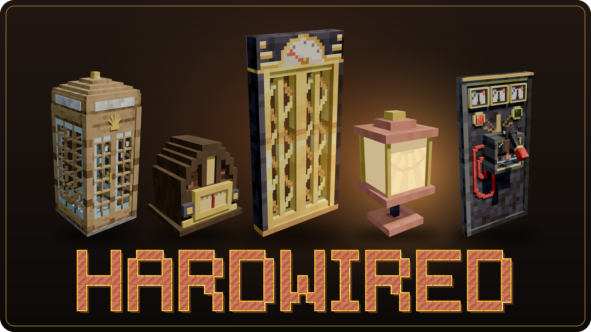
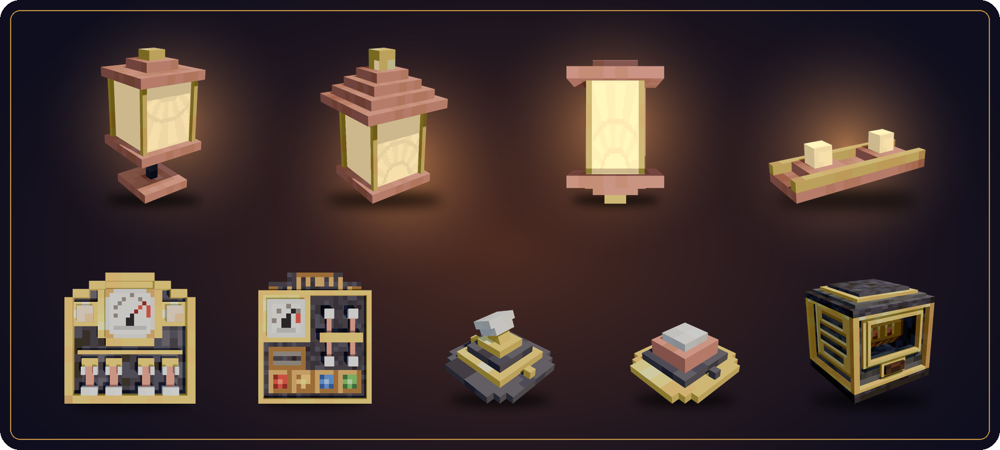
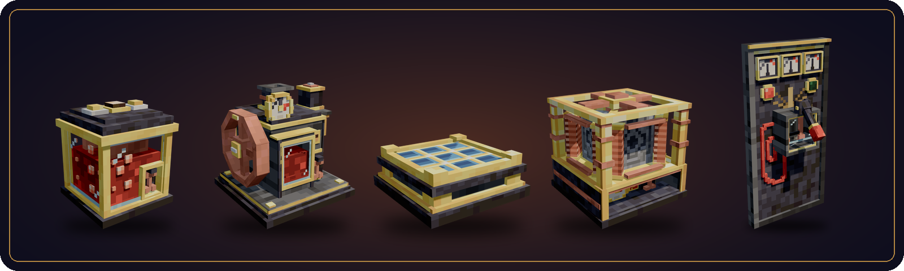
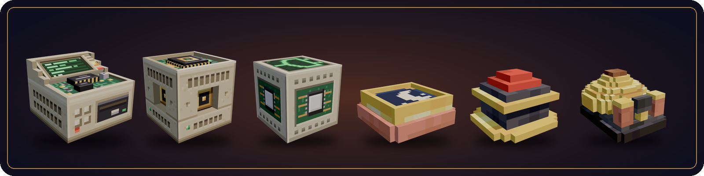
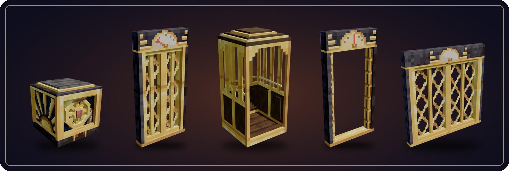
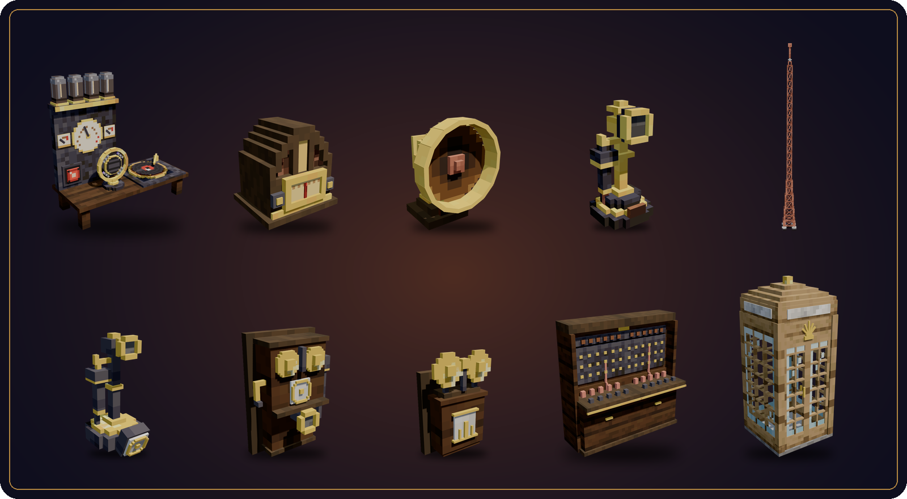

<p align="center">

</p>

<a href="https://modrinth.com/mod/hardwired"></a>
<a href="https://github.com/grabartley/minecraft-hardwired/stargazers"></a>
<a href="LICENSE"></a>
[](https://ko-fi.com/grahambartley)

<p align="center">
<a title="Fabric API" href="https://modrinth.com/mod/fabric-api" target="_blank">

</a>
</p>

# Hardwired

Hardwired brings the wonder of early electricity to Minecraft. Run hidden cloth wire through your walls, hang filament lamps on copper and brass, and wire up a whole house of switches, lifts, radios and telephones.

> **Alpha:** Hardwired is in alpha and we would love your feedback.
> [Open an issue](https://github.com/grabartley/minecraft-hardwired/issues/new) and tell us what you think.

## Light your home

<p align="center">

</p>

- **Lay wire anywhere.** Drag Copper Wire across any wall, floor or ceiling. It stays hidden until you hold wire again, comes in every dye colour, and honeycomb seals it so only you can see or change it.
- **Hang the lights.** Copper lamps, wall lights, light strips and streetlights glow warm white or any dye colour, spill that colour onto the room, and age like copper.
- **Set the mood.** Flip a Wall Switch or a Push Button, change every lamp at once from a Control Panel, save scenes for later, and run the whole house from a Main Panel.
- **Hide a door.** Set a timeline on a Controller and pistons open and close a wall from one switch.

## Power it all

<p align="center">

</p>

- **Choose your sources.** Redstone Cells, Redstone Generators, Solar Panels and Lodestone Dynamos run your wiring, and they add up as your build grows.
- **Mind the load.** Ask too much of the grid and it blows like a fuse. Lightning striking a wired rod charges your cells.
- **Throw the great switch.** Pull the Master Switch and your sources start one by one, with gauges that swing with the load.

## Build circuits

<p align="center">

</p>

- **Design logic.** Lay out gates, latches, timers and counters on a Circuit Board, test it live, then pack it into one Circuit Block you can copy.
- **Join wires.** Junctions combine wire colours with AND, OR and NOT.
- **Sense the world.** Motion Sensors and Dusk Sensors switch a wire on, so streetlights come on at dusk and an Alarm rings when someone walks in.
- **Work with redstone.** Wire drives doors, pistons and lamps it touches, and redstone can drive wire.

## Ride a lift

<p align="center">

</p>

Hang a Lift over a shaft, or a Large Lift over a wide one, and put a folding gate on every floor. Call the car, pick a floor from inside and ride up with your friends. It dings and opens when it arrives, a needle shows where the car is, and it lowers you safely if the power fails.

## On the air and on the line

<p align="center">

</p>

- **Go on the air.** Raise a radio tower, then play a disc or speak live from the Broadcast Desk to every Radio tuned in within reach. Static creeps in with distance and depth, and a Speaker carries a Radio through the house.
- **Make a call.** Wire Telephones to an Exchange and each one gets its own number. Dial a friend from a desk, a wall or a Phone Box, then talk or type, while a Bell Box rings through the house.
- **Talk between rooms.** Intercoms on the same wire send messages to each other.
- **Run a line.** Raise Telephone Poles and string wire between them to carry calls, power and signals across the map.

## Install

1. Install Fabric Loader, then put Hardwired and [Fabric API](https://modrinth.com/mod/fabric-api) in your `mods` folder.
2. Load a world and craft Copper Wire from a copper ingot and redstone.
3. Craft a Redstone Cell and fill it with redstone dust.
4. Wire the cell to a Copper Ceiling Lamp and a Wall Switch, then flip the switch.

Hardwired works in singleplayer and on servers, on Minecraft `1.21.1`. Hold `V` to talk at a Broadcast Desk or on a telephone. The key is under `Options > Controls > Key Binds`, in the Hardwired section.

## Settings

Most numbers in the mod are settings, from how far you can see hidden wire to how much power each device draws. Change them on the settings screen in Mod Menu, or with `/hardwired config`. On a server, only operators can. How wire shows, coloured light, radio static, electric hum, voices and your microphone are each player's own choice, under This Device on that same screen.

<details>
<summary><b>Commands</b></summary>

Any player can use `/hardwired` to list the settings. Every other `/hardwired` command needs operator permission.

```
/hardwired
/hardwired status
/hardwired override
/hardwired config <setting> <value>
/hardwired config reset
```

`/hardwired override` lets an operator see and change sealed wire. Each player can also change their own settings with `/hardwiredclient config <setting> <value>`.

</details>

<details>
<summary><b>Works well with</b></summary>

- **[Mod Menu](https://modrinth.com/mod/modmenu)** adds the settings screen to your mods list. Without it, operators can still change every server setting with commands.

</details>

<details>
<summary><b>Requirements</b></summary>

Minecraft `1.21.1` on Java `21`.

| Mod           | Version            |
|---------------|--------------------|
| Fabric Loader | `>=0.16.5`         |
| Fabric API    | `>=0.107.0+1.21.1` |

</details>

## Languages

Hardwired is in English, Simplified Chinese (简体中文), German (Deutsch), French (Français), Portuguese (Português do Brasil), Russian (Русский) and Spanish (Español).

Want to add your language? Copy [`en_us.json`](src/main/resources/assets/hardwired/lang/en_us.json), translate the text, and open a pull request. Keep the keys, the `%s` and `%%` placeholders, the `\n` line breaks and the `§` codes as they are, and leave command names and arguments untranslated. Found a mistake in a translation? [Open an issue](https://github.com/grabartley/minecraft-hardwired/issues/new).

## Documentation

How every part of the mod is meant to work is written down in the [product requirements](docs/prd.md). How it is built is in the [engineering standards](docs/standards.md) and the [decision records](docs/adr/README.md).

## Credits

Hardwired is released under the [MIT License](LICENSE).

The radio static and the power sounds are real recordings, each released under CC0. Everything else is original work or comes from the base game.

<details>
<summary><b>Sounds</b></summary>

The radio static is cut from one recording on OpenGameArt. The power sounds are cut and layered from recordings on Freesound.

- Radio Noise 1, by Kresiek The Furry, OpenGameArt, CC0 1.0
- Brass_Switches_and_Levers_Steampunk/Dieslpunk, by SoundsofTheMachine, [link](https://freesound.org/s/797930/), CC0 1.0
- Switch.Big.Power.wav, by jessepash, [link](https://freesound.org/s/139970/), CC0 1.0
- Electrical Relays, Very Large, Close and, by CHallSmith, [link](https://freesound.org/s/870770/), CC0 1.0
- Electric Sparks.wav, by kev_durr, [link](https://freesound.org/s/396470/), CC0 1.0
- Spark.wav, by BMacZero, [link](https://freesound.org/s/94132/), CC0 1.0
- 130kV Power line short circuit, by prophecy77, [link](https://freesound.org/s/728157/), CC0 1.0
- switch big breaker metal click on, off.flac, by kyles, [link](https://freesound.org/s/451933/), CC0 1.0
- motor b 1.wav, by jameswrowles, [link](https://freesound.org/s/327564/), CC0 1.0
- Motors_1920s_Drivebelt_Spin_Squeel, by SoundsofTheMachine, [link](https://freesound.org/s/754343/), CC0 1.0
- hum electric transformer in large room2.flac, by kyles, [link](https://freesound.org/s/453445/), CC0 1.0
- Fluorescent Lightbulb Break.wav, by sandb1ns, [link](https://freesound.org/s/558969/), CC0 1.0
- Stationary Petrol-Gas-Engine 2.wav, by mike_stranks, [link](https://freesound.org/s/407396/), CC0 1.0
- Fizzing Acid, by iainmccurdy, [link](https://freesound.org/s/713705/), CC0 1.0
- Antique Pocket Watch Ticking and Winding, by apintofmild, [link](https://freesound.org/s/847217/), CC0 1.0

</details>

If you enjoy Hardwired, a star on GitHub or a coffee on Ko-fi helps a lot.

<a href="https://ko-fi.com/grahambartley" rel="noopener nofollow ugc" target="_blank">

</a>
